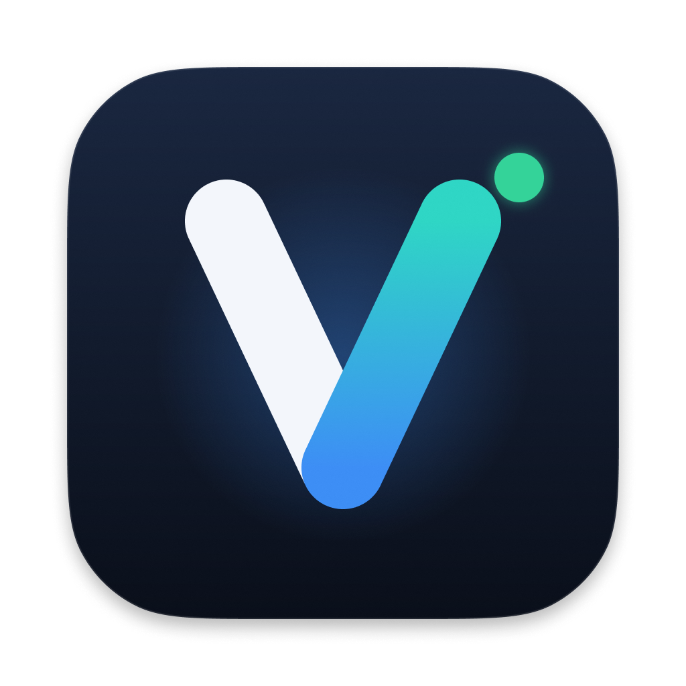
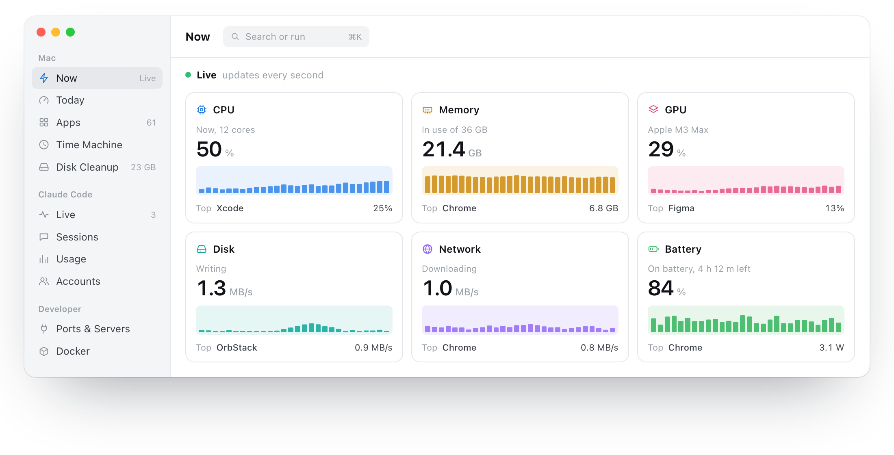

<p align="center"></p>

<h1 align="center">Vardis</h1>

<p align="center">A small activity monitor for macOS. Free, open source, collects nothing.</p>

<p align="center"></p>

## What it does

- **Now:** CPU, memory, GPU, disk, network and battery, with the app behind each.
- **Apps:** processes grouped into the apps that launched them. Quit or force quit.
- **Today and Time Machine:** a short summary of the day, and any past minute.
- **Disk Cleanup:** developer caches and old build files, moved to the Trash.
- **Claude Code:** sessions, search, token usage and plan limits.
- **Ports and Docker:** local servers and containers.
- **Menu bar:** readouts in the menu bar, and a ⌘K palette.

Requires macOS 15 or later on Apple silicon or Intel. Download it from [Releases](https://github.com/emrekasg/vardis/releases/latest). The Mac App Store build runs in Apple's sandbox and has fewer features.

## Build from source

You need Xcode 26 and [XcodeGen](https://github.com/yonaskolb/XcodeGen).

```sh
brew install xcodegen
xcodegen generate
xcodebuild -scheme Vardis build

cd Packages/VardisKit && swift test
```

## Privacy

No account, no analytics, no crash reports. See [PRIVACY.md](PRIVACY.md).

## Contributing

Issues and pull requests are welcome. See [CONTRIBUTING.md](CONTRIBUTING.md) and [SECURITY.md](SECURITY.md).

## License

[MIT](LICENSE). The Vardis name and icon are not covered by the license; forks need their own.
