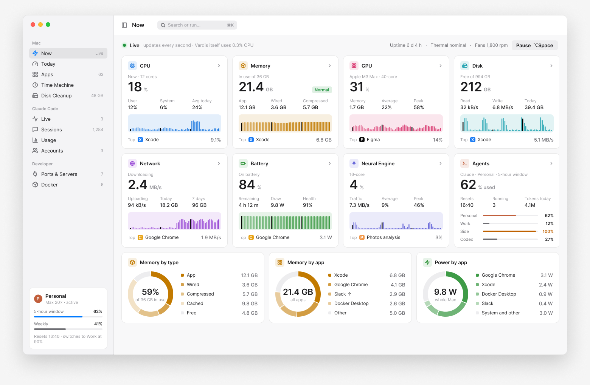
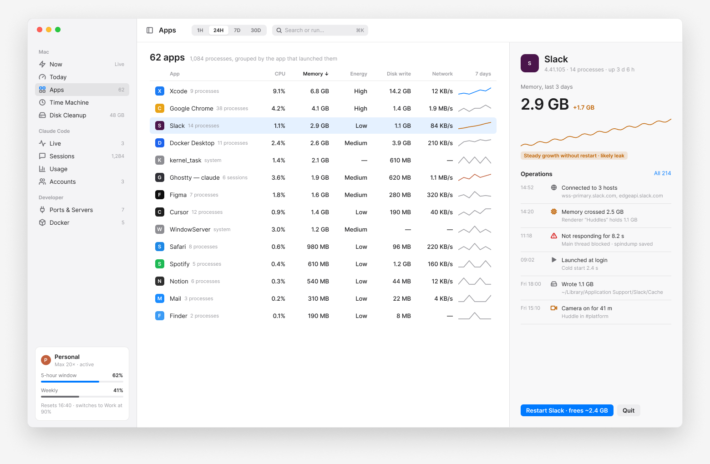
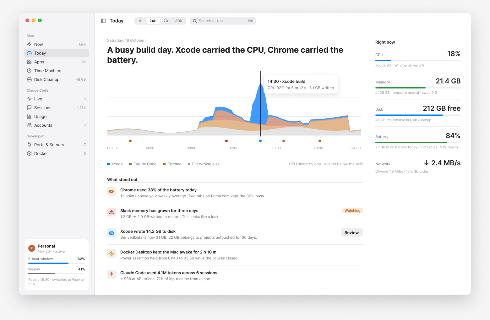
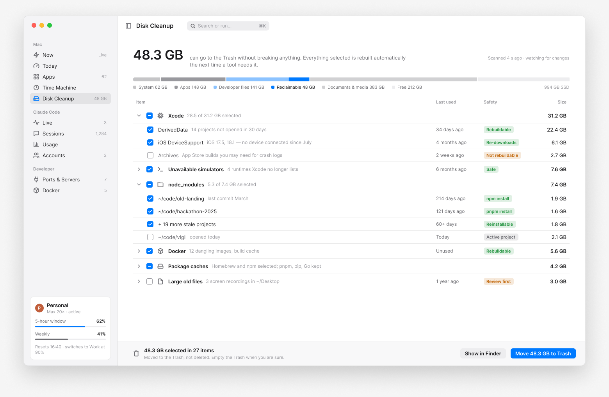
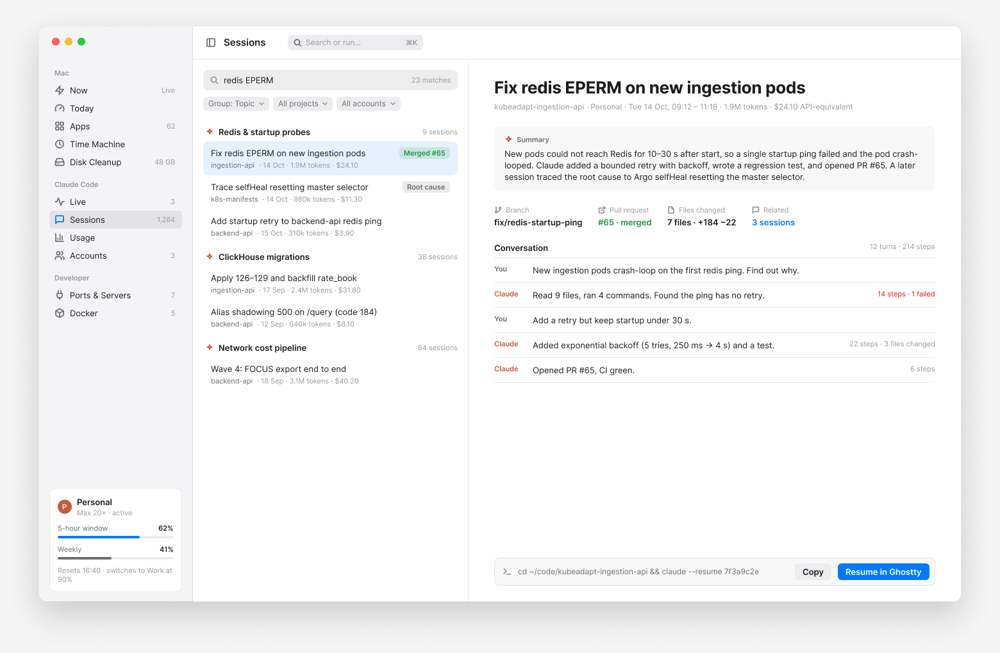
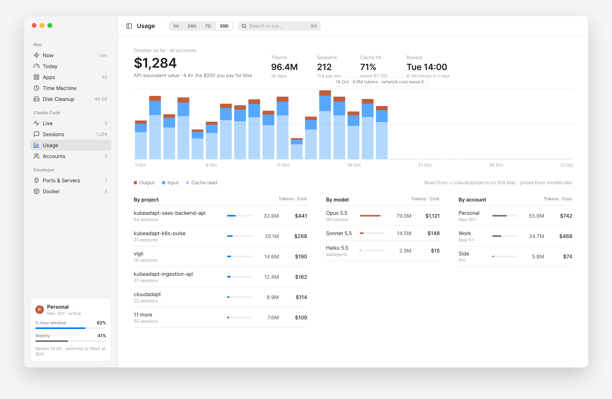
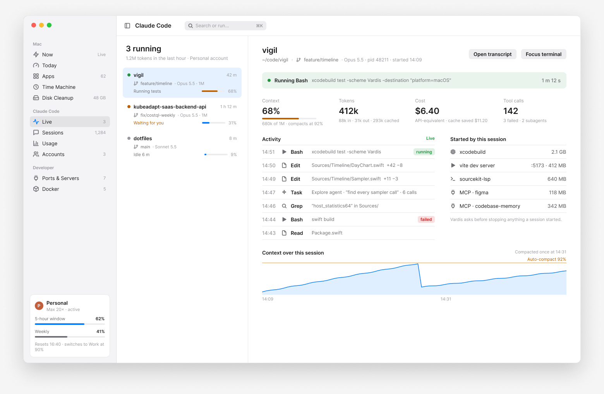
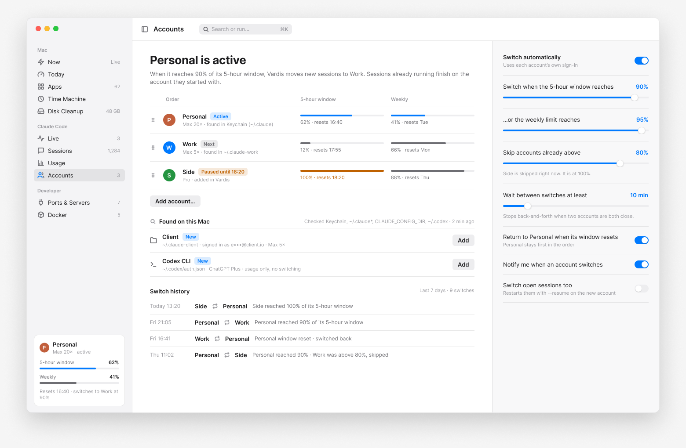
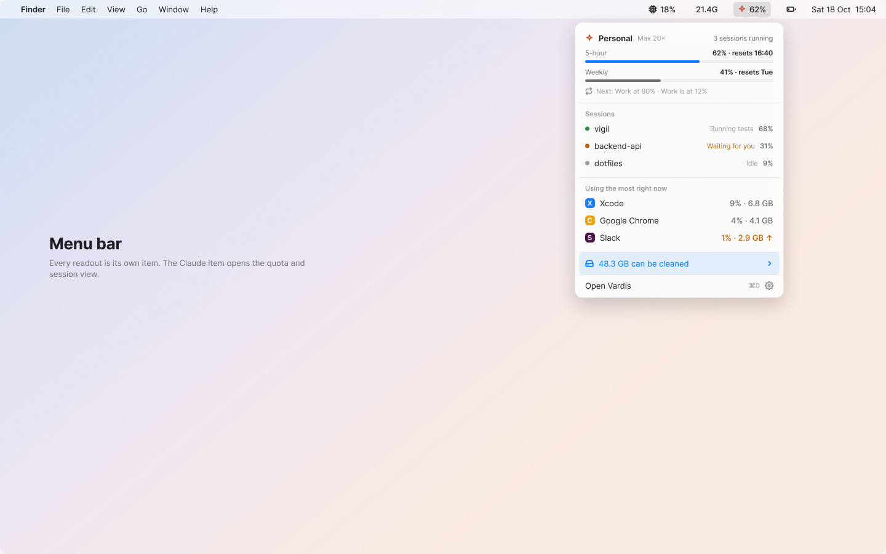

<div align="center">


# Vardis

**See what your Mac is doing right now, and why.**<br>
A fast, native macOS app for live system readouts, a rewindable history, safe developer cleanup, and Claude Code usage in view.

[](#install)
[](#install)
[](LICENSE)
[](#privacy-promise)
[](PRIVACY.md)

[Website](https://vardis.app) &nbsp;|&nbsp; [Download](https://github.com/emrekasg/vardis/releases/latest) &nbsp;|&nbsp; App Store (soon) &nbsp;|&nbsp; [Privacy](PRIVACY.md)

</div>

> [!NOTE]
> Vardis is in active development. The screenshots are the approved designs; the first release is planned for November 2026.

<p align="center">
  <picture>
    <source media="(prefers-color-scheme: dark)" srcset="brand/screens/now-dark.png">
    
  </picture>
</p>

## Why Vardis

- **It answers "why".** Activity Monitor lists a thousand processes. Vardis groups them into the sixty apps you actually run and tells you which one is using the CPU, memory, battery, disk or network.
- **It remembers.** A local history lets you rewind to the moment the fans spun up and see what was running.
- **It costs nothing and collects nothing.** No account, no analytics, no crash reports. It is free forever and the code is open.

## Features

<table>
<tr>
<td width="50%" valign="top">

### Now

Live readouts for CPU, memory, GPU, disk, network, battery and the Neural Engine, refreshed every second while the window is open, with the app responsible for each one.

</td>
<td width="50%" valign="top">

### Apps

About 1,000 processes grouped into the apps that launched them. Each app has its own operation history: hosts it connected to, memory milestones, hangs, launches and disk writes.

</td>
</tr>
<tr>
<td valign="top">

### Black box and Time Machine

A local, tiered history of everything Vardis samples. Today writes a plain summary of the day; Time Machine lets you scrub back to any moment.

</td>
<td valign="top">

### Disk Cleanup

Finds developer junk: Xcode DerivedData, old simulators, stale `node_modules`, Docker leftovers and package caches. Every item shows its size, last use and whether it rebuilds. Everything goes to the Trash, never straight to deletion.

</td>
</tr>
<tr>
<td valign="top">

### Claude Code

Finds your Claude Code data on its own and shows sessions, tokens, API-equivalent cost and your plan limits. Search past sessions and resume them in your terminal. Keep several accounts side by side.

</td>
<td valign="top">

### Menu bar

Every readout can be its own menu bar item. The Claude item opens your limits, running sessions and the apps using the most right now.

</td>
</tr>
</table>

<details>
<summary><strong>Screenshots</strong></summary>

<br>

**Apps**, with a per-app operation history



**Today**, a plain summary of the day



**Disk Cleanup**



**Claude Code sessions**



**Claude Code usage**



**Live sessions**



**Accounts**



**Menu bar**



</details>

## Fast by design

A monitor should not be the thing slowing your Mac down. These budgets are release gates, measured on an M1 with 8 GB of memory. A build that misses one does not ship.

| Moment | Budget |
|---|---|
| Open window from menu bar | < 50 ms |
| Switch screens | < 16 ms |
| Open menu bar dropdown | < 30 ms |
| One live tick, all tiles | < 2 ms main thread |
| Cold launch to menu bar item | < 150 ms |
| Session search (1,000+ sessions) | < 30 ms |
| Idle CPU, window closed | < 0.1 % |
| Idle memory, window closed | < 40 MB |

How: the window is built once at launch and kept hidden, screens read from in-memory ring buffers, charts draw in a single pass, and Claude Code transcripts are read incrementally from where Vardis last stopped. Native Swift and SwiftUI on an AppKit lifecycle. No Electron, no web views.

## Privacy promise

Vardis is free forever and collects nothing. There is no account, no analytics, no crash reporting and no telemetry SDK. Everything it reads and records stays on your Mac.

It goes online for two things only: the update check in the direct download (you can turn it off), and asking Anthropic for your own Claude plan limits using your own sign-in. The details are in [PRIVACY.md](PRIVACY.md).

## Direct download vs App Store

Both are built from the same code. The App Store version runs in Apple's sandbox, so some features are limited or unavailable there.

| Capability | Direct download | App Store |
|---|---|---|
| Your apps and processes: CPU, memory, energy, disk, network | Yes | Yes |
| System processes (via a helper) | Yes, in a later milestone | No |
| Temperatures, fans, Neural Engine sensors | Yes, in a later milestone | No |
| Disk Cleanup | Yes | Only folders you select |
| Claude Code sessions and usage from `~/.claude` | Yes | After you pick the folder once |
| Claude account discovery and switching | Yes | No, usage only |
| Updates | Built in (Sparkle) | App Store |

## Install

Requires macOS 15 or later on Apple silicon or Intel.

- **Direct download:** get the latest DMG from [GitHub Releases](https://github.com/emrekasg/vardis/releases/latest).
- **Homebrew** (after the first release):
  ```sh
  brew install --cask vardis
  ```
- **App Store:** coming soon.

## Build from source

You need Xcode 26 and [XcodeGen](https://github.com/yonaskolb/XcodeGen). The Xcode project is generated from `project.yml` and is not committed.

```sh
brew install xcodegen
xcodegen generate
xcodebuild -scheme Vardis build

# Run the package tests
cd Packages/VardisKit && swift test
```

The `Vardis` scheme builds the direct edition. `VardisAppStore` builds the sandboxed edition with the `APPSTORE` compile-time flag.

## Project layout

```
.
├── App/                    Vardis.app target: AppKit lifecycle, SwiftUI screens
│   ├── Sources/
│   └── Resources/
├── Packages/VardisKit/     Swift package, macOS 15+
│   └── Sources/
│       ├── VardisCore/     models, ring buffers, formatters, edition flags
│       ├── VardisSampling/ CPU, memory, processes, app grouping, disk, network
│       ├── VardisStore/    SQLite, tiered history, settings
│       ├── VardisClaude/   Claude Code discovery, usage, sessions, plan limits
│       └── VardisCleanup/  cleanup rules, scanner, trash
├── Config/                 Brand.xcconfig (name, bundle id, version)
├── brand/                  icon and approved screen designs
├── docs/                   design spec, plans, contributor docs
├── website/                static site for vardis.app
└── project.yml             XcodeGen project definition
```

## Roadmap

- [x] Design
- [x] Foundation scaffold
- [ ] Foundation: sampler, app grouping, live model, menu bar, Now, Apps, CI
- [ ] Claude Code: discovery, usage and cost, sessions and search, live sessions, plan limits
- [ ] Disk Cleanup
- [ ] History, Today and Time Machine
- [ ] Settings, onboarding and alerts
- [ ] Direct edition: accounts and switching, helper, sensors, per-app network, updates
- [ ] Release: App Store build, notarization, vardis.app

## Contributing

Bug reports, ideas and pull requests are welcome. Please read [CONTRIBUTING.md](CONTRIBUTING.md) first, and note that changes must keep the privacy promise and the performance budgets above. Security issues go through [SECURITY.md](SECURITY.md).

## License

The code is released under the [MIT License](LICENSE).

**Trademark:** The Vardis name and logo are not licensed under MIT. Forks are welcome under a different name and icon.
